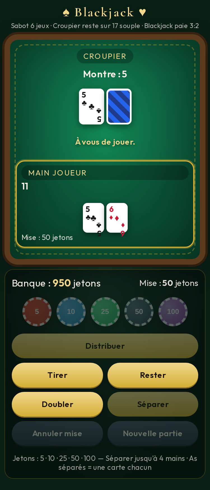

# ♠ Blackjack ♥

Un jeu de Blackjack web mobile-first avec interface en français et sabot de 6 jeux de cartes.



## 🎮 Règles implémentées

- **Sabot de 6 jeux** mélangés automatiquement
- **Le croupier reste sur 17 souple** (soft 17)
- **Blackjack paie 3:2**
- **1000 jetons de départ**
- **Actions disponibles** : Tirer, Rester, Doubler, Séparer
- **Séparation** : jusqu'à 4 mains, As séparés reçoivent une seule carte
- **Jetons** : 5, 10, 25, 50, 100
- **Remélange automatique** quand il reste environ 1,5 jeu de cartes

## 🚀 Jouer en ligne

Le jeu est déployé sur GitHub Pages :

**[https://krystoffe.github.io/Blackjack/](https://krystoffe.github.io/Blackjack/)**

## 💻 Exécution locale

1. Clonez ce dépôt :
   ```bash
   git clone https://github.com/krystoffe/Blackjack.git
   cd Blackjack
   ```

2. Ouvrez `index.html` dans votre navigateur :
   ```bash
   # Sur macOS
   open index.html
   
   # Sur Linux
   xdg-open index.html
   
   # Ou utilisez un serveur local (recommandé)
   python3 -m http.server 8000
   # Puis ouvrez http://localhost:8000
   ```

## 🧪 Tests

Le projet inclut des tests unitaires pour la logique du jeu. Pour les exécuter :

```bash
node test-logic.js
```

Les tests vérifient :
- Calcul de la valeur des mains (mains souples, as, bust)
- Détection du Blackjack
- Logique du croupier (stand sur soft 17)
- Règlement des mains (gains, égalités, pertes)
- Validité des séparations

## 📁 Structure du projet

```
.
├── index.html          # Page principale du jeu
├── style.css           # Styles (design mobile-first)
├── game.js             # Logique du jeu et interface utilisateur
├── test-logic.js       # Tests unitaires Node.js
├── screenshots/        # Captures d'écran du jeu
│   ├── screenshot.png
│   └── screenshot-mobile.png
└── README.md           # Ce fichier
```

## 🛠️ Technologies

- **HTML5** + **CSS3** (Flexbox, Grid, variables CSS)
- **JavaScript vanilla** (ES6+)
- **Mobile-first** avec viewport optimisé
- **Tests Node.js** sans dépendances externes

## 📱 Compatibilité

- ✅ Chrome/Edge (mobile et desktop)
- ✅ Safari iOS
- ✅ Firefox (mobile et desktop)
- ✅ Responsive : de 320px à grands écrans

## 📄 Licence

Projet personnel — libre d'utilisation et de modification.
