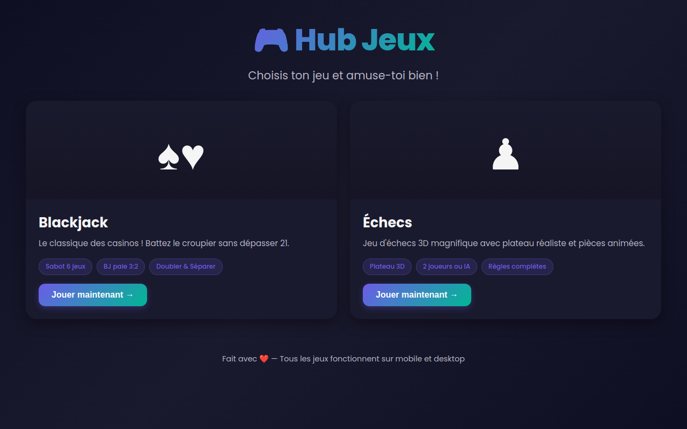

# 🎮 Hub Jeux

Un hub de jeux web interactifs avec design moderne et support mobile complet.



## 🎲 Jeux disponibles

### ♠ Blackjack ♥

Jeu de Blackjack classique avec interface française et sabot de 6 jeux de cartes.

**Règles** :
- Sabot de 6 jeux mélangés automatiquement
- Le croupier reste sur 17 souple (soft 17)
- Blackjack paie 3:2
- 1000 jetons de départ
- Actions : Tirer, Rester, Doubler, Séparer (jusqu'à 4 mains)
- As séparés reçoivent une seule carte
- Jetons : 5, 10, 25, 50, 100

### ♟ Échecs 3D

Jeu d'échecs complet avec plateau 3D magnifique et pièces animées.

**Fonctionnalités** :
- **Plateau 3D réaliste** avec Three.js
- **Pièces 3D procédurales** avec ombres et éclairage
- **Animations fluides** des mouvements
- **Caméra orbitale** avec zoom et rotation
- **Règles complètes** : échec, mat, pat, roque, en passant, promotion
- **Modes de jeu** :
  - 2 joueurs sur le même appareil
  - Contre l'ordinateur (IA minimax avec 4 niveaux de difficulté)
- **Interface** : historique des coups, pièces capturées, annulation
- **Mobile-friendly** avec contrôles tactiles

## 🚀 Jouer en ligne

Le hub est déployé sur GitHub Pages :

**[https://krystoffe.github.io/Blackjack/](https://krystoffe.github.io/Blackjack/)**

## 💻 Exécution locale

1. Clonez ce dépôt :
   ```bash
   git clone https://github.com/krystoffe/Blackjack.git
   cd Blackjack
   ```

2. Ouvrez `index.html` dans votre navigateur ou utilisez un serveur local :
   ```bash
   # Serveur Python
   python3 -m http.server 8000
   # Puis ouvrez http://localhost:8000
   
   # Ou serveur Node.js
   npx serve
   ```

3. Depuis la page d'accueil, cliquez sur le jeu de votre choix !

## 🧪 Tests

### Tests Blackjack

Le jeu de Blackjack inclut des tests unitaires pour la logique du jeu :

```bash
node blackjack/test-logic.js
```

Les tests vérifient :
- Calcul de la valeur des mains (mains souples, as, bust)
- Détection du Blackjack
- Logique du croupier (stand sur soft 17)
- Règlement des mains (gains, égalités, pertes)
- Validité des séparations

## 📁 Structure du projet

```
.
├── index.html              # Page d'accueil du hub
├── home-style.css          # Styles de la page d'accueil
├── home.js                 # Configuration des jeux
├── blackjack/              # Jeu de Blackjack
│   ├── index.html
│   ├── style.css
│   ├── game.js
│   └── test-logic.js
├── echecs/                 # Jeu d'échecs 3D
│   ├── index.html
│   ├── chess-style.css
│   └── chess-game.js
├── screenshots/            # Captures d'écran
└── .github/
    └── workflows/
        └── pages.yml       # Déploiement GitHub Pages
```

## 🛠️ Technologies

### Hub
- **HTML5** + **CSS3** (Grid, Flexbox, animations)
- **JavaScript vanilla** (ES6+)

### Blackjack
- **JavaScript vanilla** avec logique de jeu complète
- **CSS3** avec design mobile-first
- **Tests Node.js** sans dépendances

### Échecs
- **Three.js** pour le rendu 3D (plateau et pièces)
- **chess.js** pour la logique et les règles
- **IA minimax** avec élagage alpha-bêta
- **OrbitControls** pour la caméra interactive

## 📱 Compatibilité

- ✅ Chrome/Edge (mobile et desktop)
- ✅ Safari iOS
- ✅ Firefox (mobile et desktop)
- ✅ Responsive : de 375px à grands écrans
- ✅ Support tactile complet
- ✅ Optimisé pour les performances mobiles

## 🎨 Fonctionnalités

- **Design moderne** avec animations CSS
- **Mobile-first** avec navigation tactile
- **Mode sombre** sur tous les jeux
- **Architecture extensible** pour ajouter facilement de nouveaux jeux
- **Déploiement automatique** via GitHub Actions

## ➕ Ajouter un nouveau jeu

Pour ajouter un jeu au hub, modifiez `home.js` :

```javascript
const games = [
  // ... jeux existants
  {
    id: 'mon-jeu',
    title: 'Mon Jeu',
    icon: '🎯',
    description: 'Description courte du jeu.',
    features: ['Feature 1', 'Feature 2', 'Feature 3'],
    url: './mon-jeu/',
    color: '#ff6b6b'
  }
];
```

Créez ensuite un dossier `mon-jeu/` avec `index.html` et ajoutez un lien de retour vers `../`.

## 📄 Licence

Projet personnel — libre d'utilisation et de modification.
